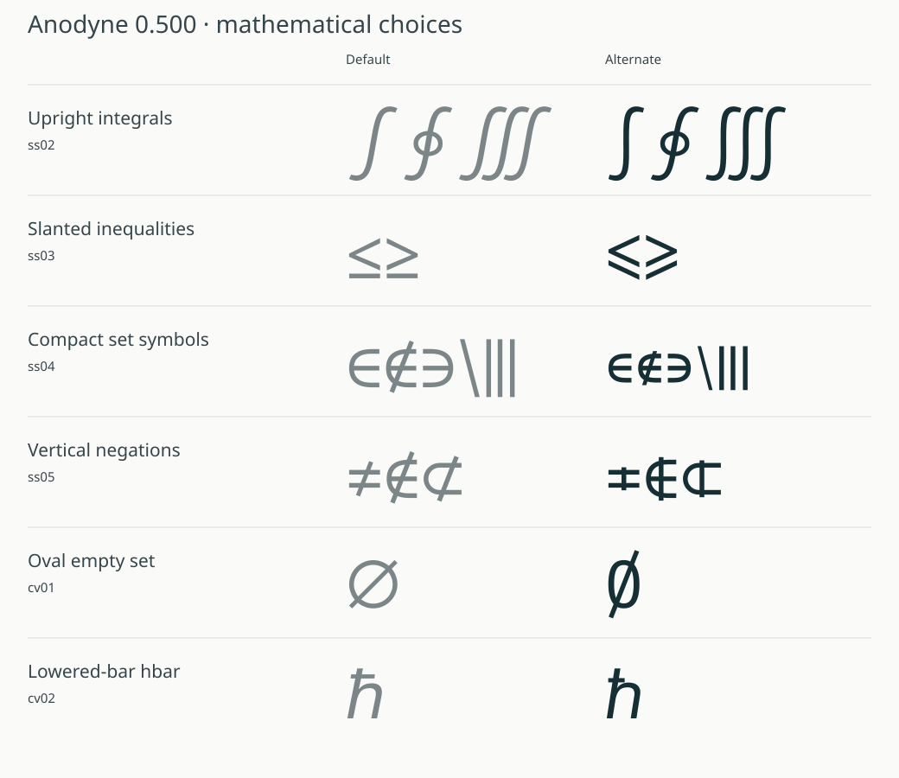
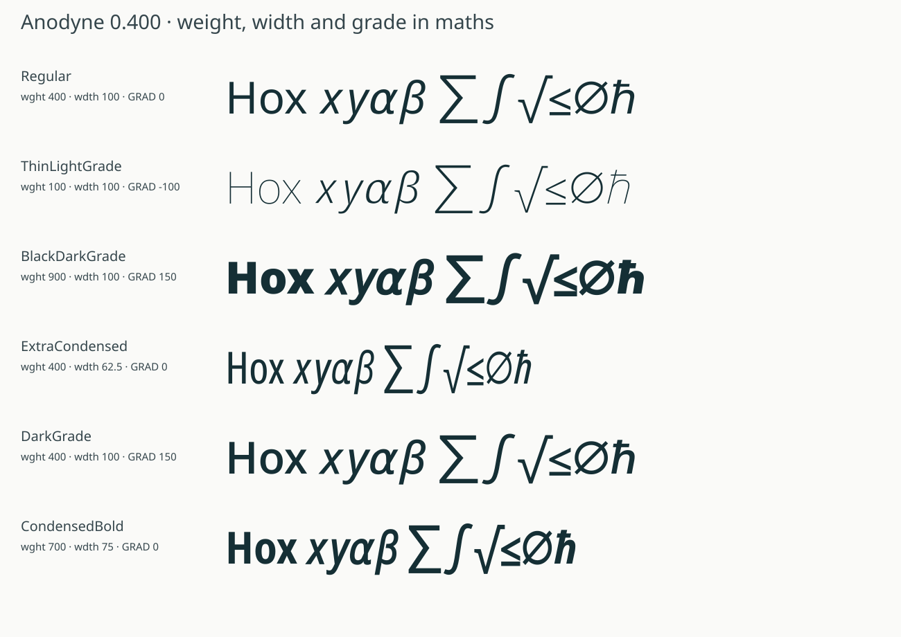

# Anodyne


**[Try it in your browser](https://japhba.github.io/anodyne/)**: weight, width, grade and features on your own text (`index.html`).

**Anodyne** is the sans-serif of [OverLyX](https://overlyx.app), a collaborative LaTeX editor: its
interface font, an editor and slide font, and a font documents can be typeset in, formulas
included. It is a fork of [Lisnoti](https://github.com/Lisnoti/Lisnoti) by Tim Gordon, which is
[Noto Sans](https://fonts.google.com/noto) with the characters that get confused in maths, science
and code redrawn (I l 1, O 0, operators on one maths axis, brackets, α), an OpenType `MATH` table
from Khaled Hosny's redesign of Noto Sans Math, and many more symbols. All of that is Lisnoti's
work; Anodyne adds:

- **Weight, 100 to 900** (`wght`). Lisnoti comes in Regular and Bold. Anodyne is a variable font:
  glyphs Lisnoti kept from Noto Sans use Noto Sans's own masters (Thin, Bold, Black, and Noto's
  weight mapping), so every weight between is Noto's design; glyphs Lisnoti redrew or added use
  Lisnoti Bold, made point-compatible with the Regular, with Thin and Black extrapolated at Noto's
  stem ratios. About 5 % of glyphs (rare symbols whose Bold has other contours) are emboldened
  point by point instead.
- **Width, 62.5 to 100** (`wdth`). Retained Noto text glyphs and restored figures use Noto Sans's native
  condensed drawings at each weight. Other letters and mathematical glyphs use the matching Noto
  character's advance ratio where it varies, their own measured stroke, and Noto's relative stem
  change. Counter compression and stroke compensation are solved together at the target advance;
  height and italic inclination are preserved. Related arithmetic and relation signs share a
  width reference so their cells remain aligned, including compound relations. Round dots retain
  their shape. These derived
  drawings are editable starting points for further optical refinement.
- **Grade, −100 to 150** (`GRAD`). Grade gives the stems of a lighter or heavier weight at the widths
  of the current one, so text darkens or lightens without reflowing: for light text on dark
  backgrounds (OverLyX takes 25 off in its dark theme), for screens and projectors that wash text
  out, for emphasis that must not move a line. Grade 100 is roughly the stem of weight 500 at the
  widths of 400. Grade masters cover every weight/width corner; the effect saturates at Thin and
  Black so negative grade cannot erase Thin’s strokes. Kerning stays fixed across grade too.
- **The features Lisnoti dropped** while keeping their glyphs: small capitals (`smcp`, `c2sc`), so
  `\textsc` and small-caps headings have real ones; old-style, proportional, tabular and lining
  figures (`onum`, `pnum`, `tnum`, `lnum`) with Noto's open default zero and native substitution order;
  an explicitly selected slashed zero (`zero`); case forms (`case`, retaining maths-axis brackets);
  the Greek alternates (`ss06`, `ss07`); and Noto Sans Math's dotless
  i and j for accents (`dtls`).
- **Formulas set as Computer Modern sets them** (0.3). Noto Sans Math's `MATH` table, which Lisnoti
  uses, sets formulas tighter than beamer's default does with Computer Modern's symbols: subscripts on
  brackets and operators hardly drop, limits sit at half TeX's gap, a root's index is jammed against
  the sign, brackets keep the same thin margin at every size, and its tall braces are the brace
  stretched upright, hooks and beak drawn out until they look like brackets. Anodyne takes TeX's
  constants (Latin Modern Math's, the vertical ones scaled to Anodyne's x-height), and draws every size
  of `( ) [ ] { } ⌈ ⌉ ⌊ ⌋ ⟨ ⟩` again from its own text-size glyph the way Computer Modern's sizes grow:
  parentheses and angle brackets bow out almost in proportion to their height, a brace's hooks and
  beak grow with the square root of its height while only its arms lengthen, brackets' arms lengthen
  a little, and every stroke keeps its weight. Their margins grow on the outside only, as Computer
  Modern's do, and the extensible pieces are cut from the largest size (the closing brace gets its own
  extender). Only TeX's numbers are used: Computer Modern's outlines are under other licences.

It keeps Lisnoti's `ss01` (chancery script capitals for `\mathcal`), fractions, super- and
subscripts, and Unicode's maths alphanumerics.

Version 0.500 restores Noto's ordinary zero and numeral substitutions. Slashed zero is an
explicit `zero` feature. Mathematical monospace retains Noto Sans Math's native dotted zero;
its Latin, Greek and digit cells now share consistent advances across the three axes.
Historical script, fraktur and double-struck letterlikes such as ℬ, ℌ, ℍ and ℘ receive compatible
stroke-derived weight masters where the upstream supplies static forms. Their Regular drawings
are preserved, and their dotless variants and Greek borrowers follow the same repair.

Version 0.400 adds six named mathematical choices. Their feature conventions are inspired by
the comparison fonts; the drawings use Anodyne’s own glyphs, with no imported donor outlines.

| Feature | Choice | Example |
|:--|:--|:--|
| `ss02` | Upright integrals, including display sizes and mirrored forms | ∫ ∮ ∭ |
| `ss03` | Slanted inequalities | ≤ ≥ |
| `ss04` | Compact set symbols | ∈ ∉ ∋ ∖ ∣ ∥ |
| `ss05` | Vertical negation strokes | ≠ ∉ ⊄ |
| `cv01` | Oval empty set instead of the circular default | ∅ |
| `cv02` | Lowered bar on the reduced Planck constant | ℏ |

All six choices participate in weight, width and grade. Stylistic sets can be combined.
For small scripts, a tracked layout policy selects clean optical alternates or the normal
drawing for 24 families whose reconstructed script forms developed spikes at extreme weights.
Script scaling and Unicode semantics stay the same; `sources/layout-fixes.json` records each choice.



Version 0.500 adds seven Greek mathematical alphabets, with full uppercase and lowercase
coverage, final sigma, mathematical symbol variants, modern accents and the source font's
polytonic forms. Each family styles 303 Greek characters while preserving their Unicode text.
The Greek-specific drawings are Anodyne interpretations; shared capital forms retain the
existing Latin alphabet drawings, and lowercase homographs are sized to the Greek x-height.

| Feature | Greek alphabet |
|:--|:--|
| `ss08` | Roundhand script |
| `ss09` | Bold script |
| `ss10` | Fraktur |
| `ss11` | Bold fraktur |
| `ss12` | Double-struck |
| `ss13` | Monospace |
| `ss14` | Chancery script |

Every family follows weight, width and grade. Monospaced Greek shares one cell with the Latin
mathematical monospace alphabet and digits. Breathing/tone combinations retain the original
accent designs; iota subscript sits below the styled body. Unicode has no encoded Greek script,
fraktur or monospace blocks, so named OpenType features supply those styles.

Historical mathematical letterlike symbols such as ℬ, ℌ, ℍ and ℘ also follow the axes.
Where the source font supplied static ink, Anodyne preserves Regular and derives compatible
stroke changes using the existing alphabet's weight progression and bounded local thickness.
Already varying optical and chancery drawings retain their original weight motion. Condensation
uses the underlying letter's width reference instead of a static text-symbol drawing.

[See all seven Greek alphabets](images/greek-math-styles.png), with
[vector SVG](images/greek-math-styles.svg) and [print PDF](images/greek-math-styles.pdf).


[Full-resolution PNG](images/math.png) · [Vector SVG](images/math.svg) · [Print PDF](images/math.pdf).
The mathematical test expressions follow
[Henri Menke's Stack Exchange example](https://tex.stackexchange.com/q/425098), also used in
[OverLyX's font preview](https://github.com/japhba/overlyx/blob/90cd4e50844dbc713d9ce0345900deec242d6ed8/packages/client/src/app/Settings.tsx#L155).
The explanatory wording, layout and extra Anodyne examples are new. The adapted specimen is
[CC BY-SA 4.0](https://creativecommons.org/licenses/by-sa/4.0/), from the original
[CC BY-SA 3.0](https://creativecommons.org/licenses/by-sa/3.0/) example; the font remains SIL OFL 1.1.

## Files

| Folder | What |
|:--|:--|
| `fonts/variable/` | `Anodyne[GRAD,wdth,wght].ttf` and `Anodyne-Italic[GRAD,wdth,wght].ttf`: every weight, width and grade |
| `fonts/static/` | Regular, Bold, Italic and Bold Italic at normal width and grade 0, each with the `MATH` table: for desktop apps and LuaLaTeX |
| `fonts/webfonts/` | the variable fonts as woff2 by Unicode range (Latin, Latin extended, Greek, Cyrillic, symbols, maths, maths alphabets) and `anodyne.css` |
| `fonts/mathwebfonts/` | complete variable WOFF2 fonts retaining MATH and variable positioning, with `anodyne-math.css`, for MathML |
| `sources/` | pinned inputs, compatible source preparation, editable master compiler, math features, instance export and release checks |

## Use it

**On the web**, copy `fonts/webfonts/` to your site and link its stylesheet. A page fetches only the
ranges its text uses, with every weight, width and grade in each subset.

```html
<link rel="stylesheet" href="/webfonts/anodyne.css">
```
```css
body { font-family: Anodyne, sans-serif; }
@media (prefers-color-scheme: dark) { body { font-variation-settings: "GRAD" -25; } }
```

Any weight from 100 to 900 works with `font-weight`, any width from 62.5 % to 100 % with `font-stretch`;
grade with `font-variation-settings: "GRAD" <n>`.

For browser formulas, also copy `fonts/mathwebfonts/` and link its stylesheet. The regular text
subsets omit the MATH table; use the dedicated math family for actual MathML layout:

```html
<link rel="stylesheet" href="/mathwebfonts/anodyne-math.css">
```
```css
math {
  font-family: "Anodyne Math";
  font-variation-settings: "wght" 550, "wdth" 75, "GRAD" 50;
  font-feature-settings: "ss03" 1;
}
math mo.upright-integral { font-family: "Anodyne Math Upright"; }
math mi.chancery { font-family: "Anodyne Math Chancery"; }
```

Browser math engines can select enlarged integrals and script letters before applying GSUB.
The stylesheet includes small variable adapter fonts for those two cases; apply the corresponding
family to the integral `mo` or script `mi` token. Unicode characters and mathematical size variants
are preserved. The demo applies these families automatically when their feature switches are on.

The same stylesheet supplies the seven Greek adapter families. For a script Greek token:

```html
<math><mi class="greek-script" mathvariant="normal">Ααἄ</mi></math>
```
```css
math mi.greek-script { font-family: "Anodyne Greek Script", "Anodyne Math"; }
```

`mathvariant="normal"` keeps the browser from remapping the original Greek before the adapter
selects its drawings. The demo also routes Greek inside `\mathcal`, `\mathscr`, `\mathfrak`,
`\mathbb` and `\mathtt`; bold script and fraktur have their own families.

**On a computer**, install the four files in `fonts/static/` (or the two variable ones, if your
apps handle variable fonts).

**In LaTeX** (LuaLaTeX or XeLaTeX), with the static files installed or next to the document:

```latex
\usepackage{unicode-math}
\setmainfont{Anodyne}
\setsansfont{Anodyne}
\setmathfont{Anodyne}
\setmathfont{Anodyne Bold}[version=bold]
\setmathfont{Anodyne}[range=\mathcal, StylisticSet=1]
```

As with Lisnoti: load `amsmath` before these lines, and keep the `\mathcal` line after the bold one.
LuaLaTeX also sets the variable font by axis, for any weight, width and grade, e.g.
`\fontspec{Anodyne}[RawFeature={axis={wght=550,wdth=75,GRAD=50}}]` with the variable file installed
under its own name. Anodyne is a large font for LuaTeX: caching each face the first time takes about
0.8 GB, so a first run that loads all of them at once needs a few GB.

For upright integrals and slanted inequalities together:

```latex
\setmathfont{Anodyne}[StylisticSet={2,3}]
```

To assign the Greek letters a roundhand family, explicitly select their Unicode ranges:

```latex
\setmathfont{Anodyne}[
  range={"0370-"03FF,"1D6A8-"1D7CB}, StylisticSet=8]
% $\alpha+\Gamma+\acute{\alpha}+\ddot{\iota}$
```

Choose sets 9–14 for the other Greek families. Use structured math accents such as
`\acute{\alpha}`: `unicode-math` does not automatically assign mathcodes to every precomposed
accented Greek literal. Text shaping and the browser adapters support the 303 Greek characters
directly, including NFC and decomposed accents.

### Weight, width and grade in maths

The mathematical alphabets, operators, radicals, accents, delimiter variants and assembly glyphs
all vary. Accent attachments, italic corrections and mathematical rule thicknesses carry variable
MATH records. Positioning follows weight and width; grade preserves shaped text advances.
An engine can still adjust a formula’s layout when its math corrections or ink bounds change.



Some MATH fields, including stretchy-glyph variant measurements and assembly advances, are plain
integers without variation records. Direct variable math therefore depends on the layout engine,
especially for very large constructions. For reliable final geometry in TeX and desktop apps,
export a static math face at any supported axis location:

```sh
make instance AXES='--weight 550 --width 75 --grade 50'
# Prints the output path and unique font family name.
```

This resolves variable layout values and recalculates variant and assembly measurements from
the final outlines. It preserves MATH and all stylistic choices. Pass `--italic` for an italic
face, or `--output path/to/font.ttf` for a chosen destination. In LaTeX, load the resulting file
with `\setmathfont{path/to/font.ttf}`.

## How it is built

The canonical build lives in this repository. `sources/source-lock.json` pins upstream commits,
font files, licenses and SHA-256 hashes; `requirements.lock` pins the compiler dependencies.
Downloads use atomic writes and cached files are verified. `SOURCE_DATE_EPOCH` controls timestamps.

Preparation normalizes Lisnoti Regular/Bold into compatible drawings once, combines them with
Noto’s weight/width designs and positioning, and writes 24 standard UFO 3 masters per style with
a designspace. UFOZ archives keep the complete source set compact. Layout and MATH tables are
editable TTX sidecars inside each master. Compilation reads these saved sources through ufo2ft,
the compiler used by fontmake, and varLib; it does not repeat contour matching.

The Thin, Black and condensed Lisnoti additions are **compatible bootstrap drawings**, with
bounded extrapolation and synthetic condensed forms. They are editable starting points, not a
claim that every symbol has been independently drawn and optically reviewed. Reviewed source
replacements belong in `sources/overrides/`; `sources/master-plan.json` documents the source layout.

```sh
make setup                          # Python 3.12+ and python3-venv required
make prepare                        # verify inputs; prepare compatible sources once
make build                          # compile sources into build/dist/
make release                        # also update this checkout’s fonts/ distribution
make check                          # regression tests and OpenType sanitizer
make qa                             # also run the FontBakery release policy
make sources                        # archive the complete editable sources
make package                        # build and zip the font distribution
```

`make check` requires the system `opentype-sanitizer` package. FontBakery checks static and variable
installation cohorts separately; its release policy and the two inherited Italic diagnostics are
recorded in `sources/qa-policy.json`, with unfiltered reports retained in `build/fontbakery/`.
Formula proofs additionally require
LuaLaTeX, unicode-math, standalone and Poppler (Ubuntu packages `texlive-luatex`,
`texlive-latex-extra`, `texlive-fonts-recommended`, `poppler-utils`):

```sh
build/venv/bin/python sources/proof.py
```

To regenerate the published full formula image, Greek alphabet sheet and text specimens:

```sh
make qa-setup
make specimen
```

The full formula source is [sources/specimen/math.tex](sources/specimen/math.tex).
[render_specimen.py](sources/render_specimen.py) typesets it to PNG, outlined SVG and PDF;
[render_greek_specimen.py](sources/render_greek_specimen.py) and
[render_text_specimen.py](sources/render_text_specimen.py) draw shaped glyphs directly from
the variable font. The renderers record font hashes and normalize PDF dates to
`SOURCE_DATE_EPOCH`. The Greek renderer also accepts `--weight`, `--width` and `--grade`
for independent proofs of an axis location. These image commands use the QA environment's
CairoSVG dependency in addition to the TeX/Poppler tools above.

The proof command produces six PDFs and PNGs spanning the axes, plus outline comparisons of the
new features. It fails on missing formula glyphs. `sources/check.py` checks all packaged fonts,
grade invariance of glyph and shaped-text advances, representative outline winding at axis
corners, variable math measurements and construction references.

To edit masters, run `make edit`, open the unpacked UFOs/designspaces in a font editor, then
`make build`. Unpacked sources take precedence over their UFOZ archives. Preparation preserves
current source edits and refuses to overwrite unpacked UFOs when generator inputs change. Keep
intentional replacement glyphs in tracked override UFOs so they survive future preparation.
Compiled styles are cached by source, override, compiler and dependency hashes; a changed or
corrupted output is rebuilt. `make sources` includes the complete prepared masters, tests and
demo assets so the source release can be rebuilt and checked independently.

OverLyX should consume release artifacts from this repository. The legacy `build.py --repo`
adapter still emits the web/TeX layout it expects, using the same canonical subset definitions.

## Demo development

The demo compares up to four fonts at a shared sample size, with search and filters for script,
integral and other mathematical capabilities. Its Anodyne playground accepts editable TeX and
renders native MathML, with live weight, width, grade and stylistic choices. A self-hosted,
input-only MathJax bundle parses TeX; Anodyne supplies the displayed glyphs and MATH layout data.

```sh
npm ci
npm run build:tex                   # rebuild the pinned TeX input bundle
npx playwright install chromium
npm run test:browser                # comparison controls and mobile layout
npm run test:math-browser           # actual rendered feature changes and TeX editing
```

Browser QA serves the checkout locally. The parser and its license notices are committed, so
the published demo needs no third-party runtime script or font service.

## Licence

SIL Open Font License 1.1 ([OFL.txt](OFL.txt)), with the copyright notices of Noto Sans, Noto Sans
Symbols, Noto Sans Math, Lisnoti and Anodyne. "Lisnoti" is a Reserved Font Name of Lisnoti, which is
why this changed version has a name of its own. Anodyne reserves no name.

Version 0.500, built from Lisnoti 2.006 (commit `6642e5b`, 3 Nov 2026), Noto Sans 2.015 and Noto Sans Math 3.000.
