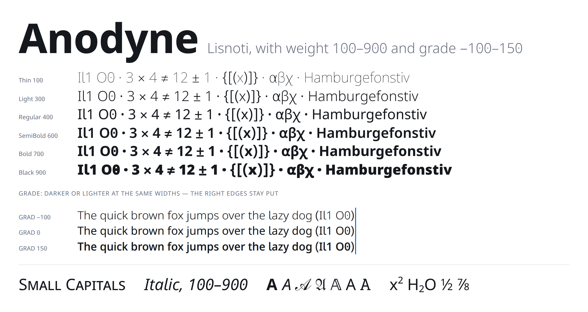
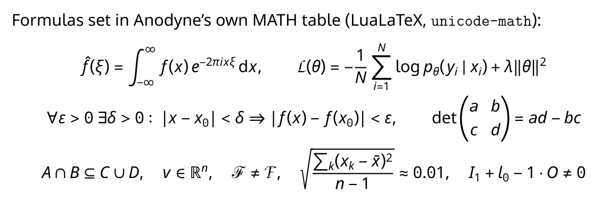

# Anodyne

<picture><source media="(prefers-color-scheme: dark)" srcset="images/specimen-dark.png"></picture>

**Anodyne** is the sans-serif of [OverLyX](https://overlyx.app), a collaborative LaTeX editor: its
interface font, an editor and slide font, and a font documents can be typeset in, formulas
included. It is a fork of [Lisnoti](https://github.com/Lisnoti/Lisnoti) by Tim Gordon, which is
[Noto Sans](https://fonts.google.com/noto) with the characters that get confused in maths, science
and code redrawn (I l 1, O 0, operators on one maths axis, brackets, α), an OpenType `MATH` table
from Khaled Hosny's redesign of Noto Sans Math, and many more symbols. All of that is Lisnoti's
work; Anodyne adds:

- **Weight, 100 to 900** (`wght`). Lisnoti comes in Regular and Bold. Anodyne is a variable font:
  glyphs Lisnoti kept from Noto Sans use Noto Sans's own masters (Thin, Bold, Black, and Noto's
  weight mapping), so every weight between is Noto's design; glyphs Lisnoti redrew or added use
  Lisnoti Bold, made point-compatible with the Regular, with Thin and Black extrapolated at Noto's
  stem ratios. About 5 % of glyphs (rare symbols whose Bold has other contours) are emboldened
  point by point instead.
- **Grade, −100 to 150** (`GRAD`). Grade gives the stems of a lighter or heavier weight at the widths
  of the current one, so text darkens or lightens without reflowing: for light text on dark
  backgrounds (OverLyX takes 25 off in its dark theme), for screens and projectors that wash text
  out, for emphasis that must not move a line. Grade 100 is roughly the stem of weight 500 at the
  widths of 400.
- **Small capitals** (`smcp`, `c2sc`), which Lisnoti dropped, back from Noto Sans, so `\textsc` and
  small-caps headings have real ones.

It keeps Lisnoti's `ss01` (chancery script capitals for `\mathcal`), fractions, super- and
subscripts, and Unicode's maths alphanumerics.



## Files

| Folder | What |
|:--|:--|
| `fonts/variable/` | `Anodyne[GRAD,wght].ttf` and `Anodyne-Italic[GRAD,wght].ttf`: every weight and grade |
| `fonts/static/` | Regular, Bold, Italic and Bold Italic at grade 0, each with the `MATH` table: for desktop apps and LuaLaTeX |
| `fonts/webfonts/` | the variable fonts as woff2 by Unicode range (Latin, Latin extended, Greek, Cyrillic, symbols, maths, maths alphabets) and `anodyne.css` |
| `sources/` | the build: `build.py` and `fetch-sources.sh` |

## Use it

**On the web**, copy `fonts/webfonts/` to your site and link its stylesheet. A page fetches only the
ranges its text uses (about 125 kB for Latin).

```html
<link rel="stylesheet" href="/webfonts/anodyne.css">
```
```css
body { font-family: Anodyne, sans-serif; }
@media (prefers-color-scheme: dark) { body { font-variation-settings: "GRAD" -25; } }
```

Any weight from 100 to 900 works with `font-weight`; grade with `font-variation-settings: "GRAD" <n>`.

**On a computer**, install the four files in `fonts/static/` (or the two variable ones, if your
apps handle variable fonts).

**In LaTeX** (LuaLaTeX or XeLaTeX), with the static files installed or next to the document:

```latex
\usepackage{unicode-math}
\setmainfont{Anodyne}
\setsansfont{Anodyne}
\setmathfont{Anodyne}
\setmathfont{Anodyne Bold}[version=bold]
\setmathfont{Anodyne}[range=\mathcal, StylisticSet=1]
```

As with Lisnoti: load `amsmath` before these lines, and keep the `\mathcal` line after the bold one.

## How it is built

`sources/build.py` (Python with fontTools and brotli; about 11 minutes) reads Lisnoti 2.006 and
Google's variable Noto Sans and writes the variable fonts, the statics and the license. Regular and
Bold of Lisnoti's own glyphs come from separately converted TrueType files, so their points rarely
correspond; the build matches each glyph's contours, aligns their on-curve points along each
contour, inserts the points one master has and the other lacks at the same arc-length fraction,
refits each run as a cubic and converts both with cu2qu's multi-master conversion, as fontmake does,
then checks that the half-way outline lies between the masters. Grade masters are the weight
masters with the advance growth spread back across each glyph by its points' positions, so stems
change and widths do not.

```sh
sh sources/fetch-sources.sh            # Lisnoti and Noto Sans into ./src
python3 sources/build.py --lisnoti src/lisnoti/font-Lisnoti/Lisnoti-ttf --noto src/noto --out build
```

The build is maintained in the OverLyX repository (`scripts/anodyne/build.py`); its `--repo` option
writes the web and TeX files OverLyX serves.

## Licence

SIL Open Font License 1.1 ([OFL.txt](OFL.txt)), with the copyright notices of Noto Sans, Noto Sans
Symbols, Noto Sans Math, Lisnoti and Anodyne. "Lisnoti" is a Reserved Font Name of Lisnoti, which is
why this changed version has a name of its own. Anodyne reserves no name.

Built from Lisnoti 2.006 (commit `6642e5b`, 3 Nov 2026) and Noto Sans 2.015.
